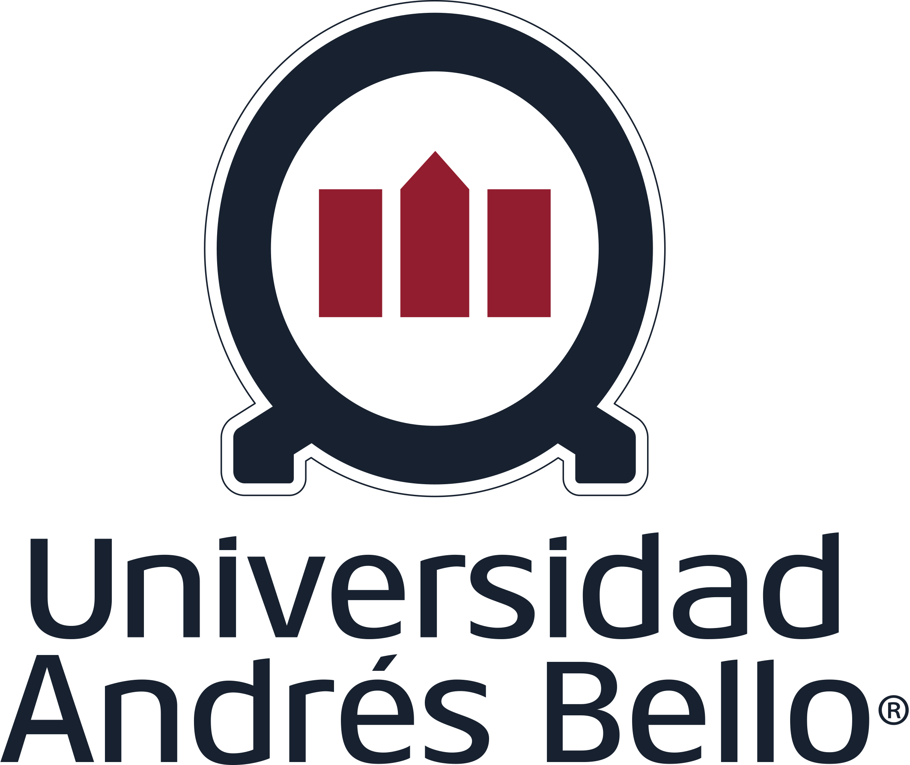
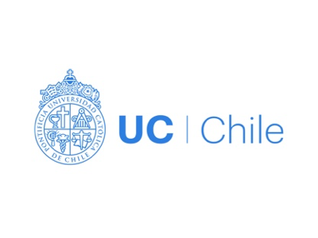
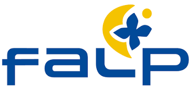
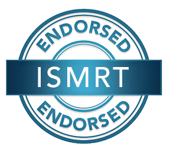
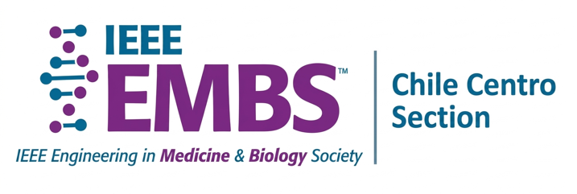
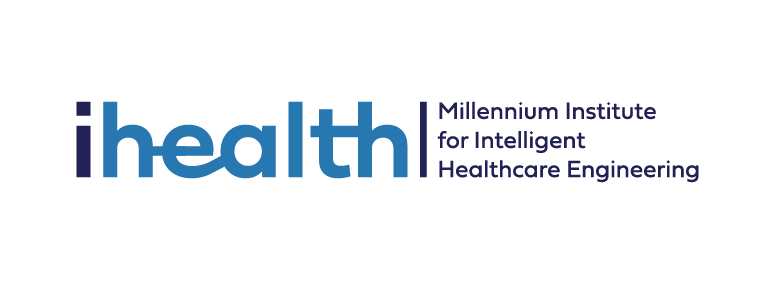
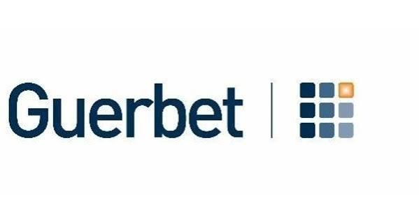
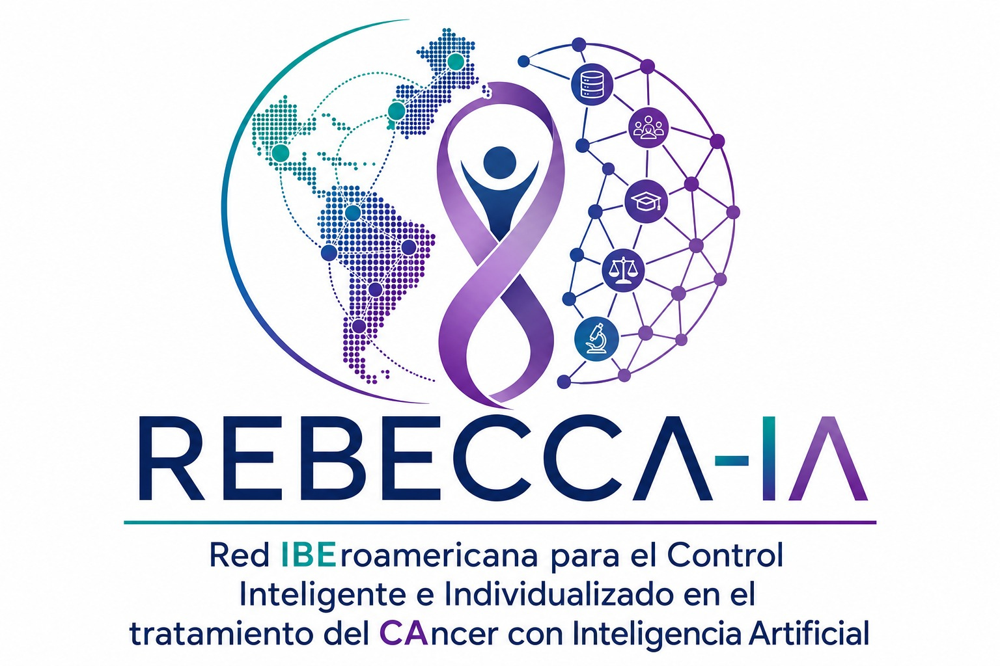

  <h1 class="ws-main-title">Workshop: IA Interpretable en Neurooncología</h1>
  Decodificando la severidad tumoral mediante resonancia multimodal
  <a href="https://www.ismrm.org/meetings-workshops/endorsement-request/" target="_blank" rel="noopener noreferrer" class="ws-badge-endorsement">
    <svg width="16" height="16" viewBox="0 0 24 24" fill="none" stroke="currentColor" stroke-width="2.5" stroke-linecap="round" stroke-linejoin="round"><circle cx="12" cy="8" r="7"></circle><polyline points="8.21 13.89 7 23 12 20 17 23 15.79 13.88"></polyline></svg>
    ISMRT-Endorsed Workshop
  </a>

  
  <h2>¿Por qué asistir?</h2>

  

    

      <svg width="24" height="24" viewBox="0 0 24 24" fill="none" stroke="currentColor" stroke-width="2" stroke-linecap="round" stroke-linejoin="round"><path d="M4 19.5A2.5 2.5 0 0 1 6.5 17H20"></path><path d="M6.5 2H20v20H6.5A2.5 2.5 0 0 1 4 19.5v-15A2.5 2.5 0 0 1 6.5 2z"></path></svg>
    

    <h4>Aprende de expertos</h4>
    
Clases magistrales dictadas por referentes en medicina, física médica e inteligencia artificial.

  

  

    

      <svg width="24" height="24" viewBox="0 0 24 24" fill="none" stroke="currentColor" stroke-width="2" stroke-linecap="round" stroke-linejoin="round"><polyline points="16 18 22 12 16 6"></polyline><polyline points="8 6 2 12 8 18"></polyline></svg>
    

    <h4>Práctica con código</h4>
    
Sesiones interactivas en Python utilizando datos clínicos reales y modelos explicables.

  

  

    

      <svg width="24" height="24" viewBox="0 0 24 24" fill="none" stroke="currentColor" stroke-width="2" stroke-linecap="round" stroke-linejoin="round"><circle cx="12" cy="8" r="7"></circle><polyline points="8.21 13.89 7 23 12 20 17 23 15.79 13.88"></polyline></svg>
    

    <h4>Concurso de pósteres</h4>
    
Presenta tu investigación científica y compite por premios en efectivo y reconocimiento.

  

  

    

      <svg width="24" height="24" viewBox="0 0 24 24" fill="none" stroke="currentColor" stroke-width="2" stroke-linecap="round" stroke-linejoin="round"><path d="M17 21v-2a4 4 0 0 0-4-4H5a4 4 0 0 0-4 4v2"></path><circle cx="9" cy="7" r="4"></circle><path d="M23 21v-2a4 4 0 0 0-3-3.87"></path><path d="M16 3.13a4 4 0 0 1 0 7.75"></path></svg>
    

    <h4>Networking científico</h4>
    
Conéctate con clínicos, tecnólogos médicos, físicos e ingenieros de primer nivel.

  

  
  <h2>Información General del Evento</h2>

  

    

      <svg width="22" height="22" viewBox="0 0 24 24" fill="none" stroke="currentColor" stroke-width="2" stroke-linecap="round" stroke-linejoin="round"><rect x="3" y="4" width="18" height="18" rx="2" ry="2"></rect><line x1="16" y1="2" x2="16" y2="6"></line><line x1="8" y1="2" x2="8" y2="6"></line><line x1="3" y1="10" x2="21" y2="10"></line></svg>
    

    

      
Fecha del Evento

      
Jueves, 10 de diciembre de 2026

      
Jornada completa de charlas y talleres

    

  

  

    

      <svg width="22" height="22" viewBox="0 0 24 24" fill="none" stroke="currentColor" stroke-width="2" stroke-linecap="round" stroke-linejoin="round"><circle cx="12" cy="12" r="10"></circle><polyline points="12 6 12 12 16 14"></polyline></svg>
    

    

      
Horario Oficial

      
8:00 AM – 17:00 PM

      
GMT-4 / Hora local de Santiago, Chile

    

  

  

    

      <svg width="22" height="22" viewBox="0 0 24 24" fill="none" stroke="currentColor" stroke-width="2" stroke-linecap="round" stroke-linejoin="round"><path d="M21 10c0 7-9 13-9 13s-9-6-9-13a9 9 0 0 1 18 0z"></path><circle cx="12" cy="10" r="3"></circle></svg>
    

    

      
Modalidad Presencial

      
Auditorio Zócalo, UNAB

      
Antonio Varas 880, Providencia, Santiago.

    

  

  

    

      <svg width="22" height="22" viewBox="0 0 24 24" fill="none" stroke="currentColor" stroke-width="2" stroke-linecap="round" stroke-linejoin="round"><polygon points="23 7 16 12 16 2 23 7"></polygon><rect x="1" y="5" width="15" height="14" rx="2" ry="2"></rect></svg>
    

    

      
Modalidad Online

      
Transmisión en Vivo vía Zoom

      
Enlace enviado por correo tras el registro.

    

  

  
  <h2>Registro y Recursos</h2>

  <a href="https://docs.google.com/forms/d/e/1FAIpQLScVTNZGnZ7jFYkFfVNsTKiw_LQcgZfaXG4y_08lIPOTNVzjhA/viewform?usp=sharing" target="_blank" rel="noopener noreferrer" class="ws-btn-cta" style="background: var(--primary); box-shadow: 0 4px 14px rgba(166, 55, 55, 0.25);">
    
      <svg width="19" height="19" viewBox="0 0 24 24" fill="none" stroke="currentColor" stroke-width="2.2" stroke-linecap="round" stroke-linejoin="round"><path d="M17 21v-2a4 4 0 0 0-4-4H5a4 4 0 0 0-4 4v2"></path><circle cx="9" cy="7" r="4"></circle><path d="M23 21v-2a4 4 0 0 0-3-3.87"></path><path d="M16 3.13a4 4 0 0 1 0 7.75"></path></svg>
      Inscripción Presencial
    
    Asistencia en Auditorio UNAB
  </a>
  <a href="https://docs.google.com/forms/d/e/1FAIpQLSffyLNNJZKNM4mLKOeudr3ltQmXyKQiwgkqvS51f6Oqe73-_A/viewform?usp=publish-editor" target="_blank" rel="noopener noreferrer" class="ws-btn-cta" style="background: var(--secondary); box-shadow: 0 4px 14px rgba(7, 78, 140, 0.25);">
    
      <svg width="19" height="19" viewBox="0 0 24 24" fill="none" stroke="currentColor" stroke-width="2.2" stroke-linecap="round" stroke-linejoin="round"><polygon points="23 7 16 12 16 2 23 7"></polygon><rect x="1" y="5" width="15" height="14" rx="2" ry="2"></rect></svg>
      Inscripción Online
    
    Acceso remoto vía Zoom
  </a>
  <a href="https://docs.google.com/forms/d/e/1FAIpQLScrvB4-sUyraLQAthbE9K0Ph2O1xWT8xWlNHzRo8drDvrYp3Q/viewform?usp=sharing" target="_blank" rel="noopener noreferrer" class="ws-btn-cta" style="background: var(--accent); box-shadow: 0 4px 14px rgba(64, 44, 124, 0.25);">
    
      <svg width="19" height="19" viewBox="0 0 24 24" fill="none" stroke="currentColor" stroke-width="2.2" stroke-linecap="round" stroke-linejoin="round"><path d="M12 20h9"></path><path d="M16.5 3.5a2.121 2.121 0 0 1 3 3L7 19l-4 1 1-4L16.5 3.5z"></path></svg>
      Enviar Abstract
    
    Postulación Sesión de Pósteres
  </a>

  <a href="https://github.com/pamelaFranco/workshop_glioma" target="_blank" rel="noopener noreferrer" class="ws-pill-link" style="color: #1e293b;">
    <svg width="15" height="15" viewBox="0 0 24 24" fill="currentColor"><path d="M12 0C5.37 0 0 5.37 0 12c0 5.31 3.435 9.795 8.205 11.385.6.105.825-.255.825-.57 0-.285-.015-1.23-.015-2.235-3.015.555-3.795-.735-4.035-1.41-.135-.345-.72-1.41-1.23-1.695-.42-.225-1.02-.78-.015-.795.945-.015 1.62.87 1.845 1.23 1.08 1.815 2.805 1.305 3.495.99.105-.78.42-1.305.765-1.605-2.67-.3-5.46-1.335-5.46-5.925 0-1.305.465-2.385 1.23-3.225-.12-.3-.54-1.53.12-3.18 0 0 1.005-.315 3.3 1.23.96-.27 1.98-.405 3-.405s2.04.135 3 .405c2.295-1.56 3.3-1.23 3.3-1.23.66 1.65.24 2.88.12 3.18.765.84 1.23 1.905 1.23 3.225 0 4.605-2.805 5.625-5.475 5.925.435.375.81 1.095.81 2.22 0 1.605-.015 2.895-.015 3.3 0 .315.225.69.825.57A12.02 12.02 0 0024 12c0-6.63-5.37-12-12-12z"/></svg>
    Repositorio GitHub
  </a>
  <a href="https://docs.google.com/viewer?url=https://raw.githubusercontent.com/pamelaFranco/workshop_glioma/main/Programa/Charlas___Workshop_IA_Interpretable_Neurooncologia.pdf" target="_blank" rel="noopener noreferrer" class="ws-pill-link" style="color: var(--primary);">
    <svg width="15" height="15" viewBox="0 0 24 24" fill="none" stroke="currentColor" stroke-width="2" stroke-linecap="round" stroke-linejoin="round"><path d="M14 2H6a2 2 0 0 0-2 2v16a2 2 0 0 0 2 2h12a2 2 0 0 0 2-2V8z"></path><polyline points="14 2 14 8 20 8"></polyline><line x1="16" y1="13" x2="8" y2="13"></line><line x1="16" y1="17" x2="8" y2="17"></line><polyline points="10 9 9 9 8 9"></polyline></svg>
    Programa (PDF)
  </a>
  <a href="https://www.youtube.com/@Neuro_IA_TV" target="_blank" rel="noopener noreferrer" class="ws-pill-link" style="color: #dc2626;">
    <svg width="15" height="15" viewBox="0 0 24 24" fill="currentColor"><path d="M23.498 6.186a3.016 3.016 0 0 0-2.122-2.136C19.505 3.545 12 3.545 12 3.545s-7.505 0-9.377.505A3.017 3.017 0 0 0 .502 6.186C0 8.07 0 12 0 12s0 3.93.502 5.814a3.016 3.016 0 0 0 2.122 2.136c1.871.505 9.376.505 9.376.505s7.505 0 9.377-.505a3.015 3.015 0 0 0 2.122-2.136C24 15.93 24 12 24 12s0-3.93-.502-5.814zM9.545 15.568V8.432L15.818 12l-6.273 3.568z"/></svg>
    YouTube
  </a>
  <a href="https://www.instagram.com/neuro_artint/" target="_blank" rel="noopener noreferrer" class="ws-pill-link" style="color: #db2777;">
    <svg width="15" height="15" viewBox="0 0 24 24" fill="none" stroke="currentColor" stroke-width="2" stroke-linecap="round" stroke-linejoin="round"><rect x="2" y="2" width="20" height="20" rx="5" ry="5"></rect><path d="M16 11.37A4 4 0 1 1 12.63 8 4 4 0 0 1 16 11.37z"></path><line x1="17.5" y1="6.5" x2="17.51" y2="6.5"></line></svg>
    Instagram
  </a>
  <a href="mailto:neurooncologia.ia@gmail.com" class="ws-pill-link" style="color: #475569;">
    <svg width="15" height="15" viewBox="0 0 24 24" fill="none" stroke="currentColor" stroke-width="2" stroke-linecap="round" stroke-linejoin="round"><path d="M4 4h16c1.1 0 2 .9 2 2v12c0 1.1-.9 2-2 2H4c-1.1 0-2-.9-2-2V6c0-1.1.9-2 2-2z"></path><polyline points="22,6 12,13 2,6"></polyline></svg>
    Contacto Email
  </a>

  
  <h2>Sobre el Workshop</h2>

Este encuentro ofrece una **inmersión teórico-práctica** en el pipeline avanzado de la neurooncología de precisión. A través de un enfoque multidisciplinario, el programa aborda de forma integral el ciclo de vida del dato médico: desde la biología molecular del glioma y los principios físicos esenciales en la adquisición de Resonancia Magnética (RM), hasta el modelado predictivo de vanguardia mediante Inteligencia Artificial (IA) e interpretabilidad clínica.

  

    

      
      Física y Fisiología Avanzada
    

    
Comprensión profunda de la señal BOLD, codificación en el Espacio K y técnicas de relajometría cuantitativa.

  

  

    

      
      Microestructura y Hemodinámica
    

    
Análisis avanzado de difusión (DTI), tractografía y mecánica de fluidos mediante secuencias como TOF-MRA.

  

  

    

      
      IA Interpretable y Radiómica
    

    
Transformación de imágenes biomédicas en biomarcadores minables y análisis explicable con SHAP y mapas de atribución.

  

  
  <h2>Estructura del Programa y Charlas</h2>

  Bloque 01
  <h3>Contexto Clínico y Física de la Resonancia Magnética</h3>
  <ul class="ws-talk-list">
    <li class="ws-talk-item">
      
Panorama de la Neurooncología

      
Introducción a la heterogeneidad, espectro y desafíos en el manejo biológico del glioma.

      Dr. Héctor Ramos · FALP
    </li>
    <li class="ws-talk-item">
      
Optimización y Protocolos de RM

      
Configuración óptima de secuencias y el rol del Tecnólogo Médico en la reproducibilidad multicéntrica.

      TM. Alejandro Cerda · UNAB / ISMRT Sección Chile
    </li>
    <li class="ws-talk-item">
      
Física de la RM y Espacio K

      
Principios de la señal física, el espín y la generación de imágenes por Transformada de Fourier.

      Dr. Ignacio Espinoza · UC
    </li>
    <li class="ws-talk-item">
      
Artefactos en RM

      
Identificación matemática y física de distorsiones, aliasing y efectos del movimiento en el tejido real.

      Dr. Hernán Mella · PUCV
    </li>
  </ul>

  Bloque 02
  <h3>Fisiología, Microestructura y Dinámica Cerebral</h3>
  <ul class="ws-talk-list">
    <li class="ws-talk-item">
      
Microestructura por Difusión

      
Exploración del Tensor de Difusión (DTI), métricas de anisotropía (FA, MD) y preservación de tractos de materia blanca.

      MSc. Cristian Montalba · UC / iHEALTH
    </li>
    <li class="ws-talk-item">
      
Mapeo Funcional (fMRI)

      
El acoplamiento neurovascular, efecto BOLD y la localización de áreas elocuentes.

      Dra. M. Daniela Cornejo · UC
    </li>
    <li class="ws-talk-item">
      
Modelado BOLD con PINNs

      
Introducción a las Redes Neuronales Informadas por la Física para el microambiente tumoral.

      Dr. David Ortiz-Puerta · UV / iHEALTH
    </li>
    <li class="ws-talk-item">
      
Evaluación Medular vía fNIRS

      
Diagnósticos de la respuesta neurovascular donde la fMRI convencional posee limitaciones.

      Dr. A. Eblen-Zajjur · UA
    </li>
    <li class="ws-talk-item">
      
Hemodinámica y Biomecánica

      
Simulación de fuerzas mecánicas mediante Modelado por Elementos Finitos (FEM) y cuantificación de flujos.

      Dr. Julio Sotelo · USM / iHEALTH
    </li>
  </ul>

  Bloque 03
  <h3>Inteligencia Artificial, Radiómica e Interpretabilidad</h3>
  <ul class="ws-talk-list">
    <li class="ws-talk-item">
      
Introducción a Machine Learning

      
Pipelines supervisados aplicados a imágenes, extracción de vectores y selección de características.

      Dr. Domingo Mery · UC / iHEALTH / CENIA
    </li>
    <li class="ws-talk-item">
      
Fundamentos de Radiómica

      
Análisis computacional de descriptores de forma, intensidad y mapas de textura (GLCM).

      Dra. Paola Caprile · UC / iHEALTH
    </li>
    <li class="ws-talk-item">
      
IA en Neurooncología y SHAP

      
Fusión de datos multimodales y apertura de la "caja negra" predictiva mediante valores SHAP.

      Dra. Pamela Franco · UNAB
    </li>
    <li class="ws-talk-item">
      
Interpretabilidad Visual en Neuroimagen

      
Aplicación de algoritmos de atribución espacial (Grad-CAM, RISE, RELAX) en mapas de calor plausibles.

      Dr. Diego Mellado C. · UNAB / ITISB
    </li>
  </ul>

  
  <h2>Sesión de Pósteres y Concurso Científico</h2>

  
El workshop contará con una <strong>Sesión de Pósteres</strong> destinada a estudiantes de pregrado y postgrado para fomentar el intercambio académico en IA y Salud, evaluada por un comité científico multi-institucional.

  

    <svg width="17" height="17" viewBox="0 0 24 24" fill="none" stroke="currentColor" stroke-width="2.2" stroke-linecap="round" stroke-linejoin="round"><circle cx="12" cy="8" r="7"></circle><polyline points="8.21 13.89 7 23 12 20 17 23 15.79 13.88"></polyline></svg>
    Premio al Mejor Póster: $100.000 CLP (nacionales) o $100 USD (extranjeros) + Menciones 2° y 3° lugar
  

  <ul style="margin-bottom: 14px;">
    <li><strong>Modalidades aceptadas:</strong> Presencial (póster físico) y online (e-poster).</li>
    <li><strong>Ceremonia de cierre:</strong> Participación especial de la <strong>Dra. Liliana Jorquera</strong> (Presidenta del Capítulo <em>IEEE EMBS Chile Centro</em>), quien presentará los beneficios e invitaciones de la red de ingeniería en medicina y biología en el país.</li>
  </ul>

  
  <h2>Comités y Organización</h2>

  

    

      
Workshop Chair & Webmaster

      
Dra. Pamela Franco

      
UNAB

    

    
Gestión de endosos internacionales, dirección estratégica y plataforma web.

  

  

    

      
Scientific Committee

      <ul style="margin: 0; padding-left: 16px; font-size: 0.9rem; color: var(--dark); line-height: 1.55;">
        <li><strong>MSc. Cristian Montalba</strong> Chair · UC</li>
        <li><strong>Dra. M. Daniela Cornejo</strong> · UC</li>
        <li><strong>Dr. Ignacio Espinoza</strong> · UC</li>
      </ul>
    

  

  

    

      
Diseño y Manufactura 3D

      
Manuel Chapa, PhD(c)

      
UC

    

    
Diseño y elaboración de galardones 3D para el Concurso Científico de Pósteres.

  

  
  <h2>Alianza e Integración Internacional</h2>

  <strong>Respaldo Internacional Oficial:</strong> Este Workshop cuenta con el endoso de la <strong>ISMRT</strong> (<em>International Society for Magnetic Resonance Technicians</em>), aprobado por su comité ejecutivo durante la reunión anual en Ciudad del Cabo (<em>Cape Town</em>).

Esta actividad se presenta en el marco de <strong>REBECCA-IA</strong>, una iniciativa financiada por el Programa Iberoamericano de Ciencia y Tecnología para el Desarrollo (<strong>CYTED</strong>) e impulsada por el <a href="https://www.itm.edu.co" target="_blank" rel="noopener noreferrer">Instituto Tecnológico de Medellín (ITM)</a>.

<h3 style="text-align: center; font-size: 1.05rem; color: var(--text-muted); text-transform: uppercase; letter-spacing: 0.06em; margin-top: 30px;">Instituciones y Colaboradores</h3>

  

  

  

  

  

  

  

  

  <strong>Proyecto Endowment I+D:</strong> Investigación Clínica para la Salud (DI-07-25/ICS)

